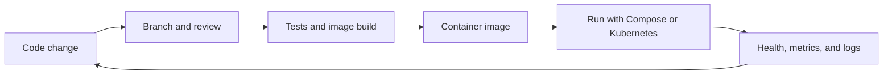

# 1. The DevOps workflow

DevOps connects software development with the work of delivering and operating software. It is a lifecycle: teams plan and change code, review it, check it automatically, package it, deploy it, observe how it behaves, and use what they learn to plan the next change.

This repository follows that lifecycle with one small Node.js API. The app accepts tasks and stores them in Redis. Docker Compose runs the app with Redis, GitHub Actions tests the app and builds an image, Kubernetes manifests describe a local deployment, and Prometheus scrapes a request counter.

Each practice reduces a different kind of uncertainty. Review helps catch design mistakes, tests catch behavior regressions, containers make runtime setup repeatable, and monitoring helps show what happened after deployment.

## Walk the workflow

1. Read `app/server.js` and identify one small change.
2. Follow the development chapter to make and review it on a branch.
3. Find the CI workflow under `.github/workflows/` and see which checks run.
4. Build and run the app using the Docker guide.
5. Deploy it to a local cluster using the Kubernetes guide.
6. Generate a request and observe the Prometheus metric and container logs.

This repository demonstrates the stages separately. It does not automatically publish an image or deploy a release; those are extension exercises.
